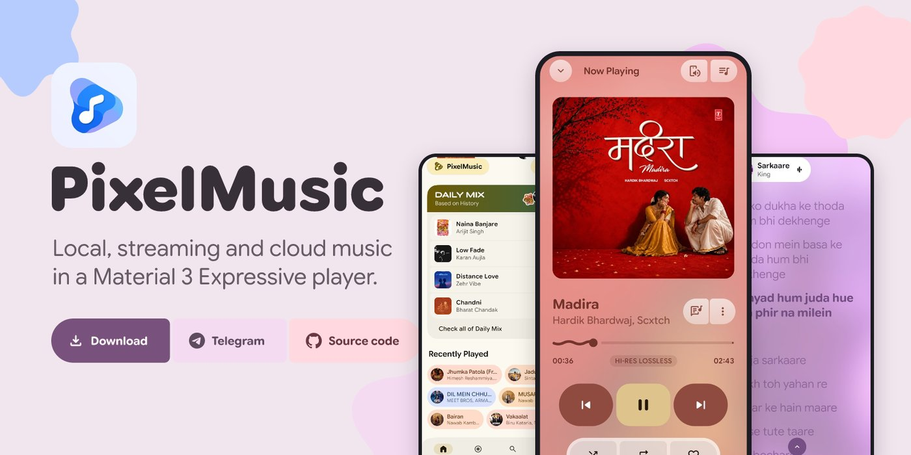

# PixelMusic Web

**The official landing page for PixelMusic, an open-source Material You music player for Android.**

[View the website](https://umangnamdeo.github.io/PIxelMuiscApp-WEB-/) · [Download the app](https://github.com/ianshulyadav/PixelMusicApp/releases) · [Report an issue](https://github.com/ianshulyadav/PixelMusicApp/issues)

 

 

## About

PixelMusic plays your local lossless library and streams YouTube Music in one lightweight app, with no ads, no tracking and no account. This repository is the website that introduces it: a fast, single-page, dark OLED design with smooth animation.

**Live at:** https://umangnamdeo.github.io/PIxelMuiscApp-WEB-/

## Highlights

- A short intro animation that plays once per visit and can be skipped
- A living galaxy background that responds to the mouse
- A bento grid of the app's main features
- Phone screenshots of Browse and Discover, Moods and Genres, Now Playing, Podcasts and Lossless FLAC
- A download card with a three-step install guide
- Fully responsive, with reduced-motion support

## Tech

Plain HTML, CSS and JavaScript in a single `index.html`. There is no framework and no build step. Screenshots and the logo are embedded in the file, and the fonts (Unbounded and DM Sans) load from Google Fonts.

## Run locally

Open `index.html` in a browser. For live reload, use the **Live Server** extension in VS Code.

## Deploy

The site is served with GitHub Pages. To publish an update, commit the changed `index.html` to the branch Pages is set to use (in the repo, under **Settings → Pages**). The new version goes live within a minute or two.

## Customize

Search `index.html` for the following:

| Change | Search for |
| --- | --- |
| Accent colors | `--v` and `--c` at the top of the style block |
| Download destination | `PixelMusicApp/releases` |
| Intro length | `setTimeout(done,2800)` |
| Footer credit | the `.by` block |

## Credits

- PixelMusic app by [ianshulyadav](https://github.com/ianshulyadav) and contributors
- Website created by [Umang Namdeo](https://github.com/Umangnamdeo)

## License

Add a `LICENSE` file to this repository and name it here. The app itself is open source; see its repository for the license that applies.
